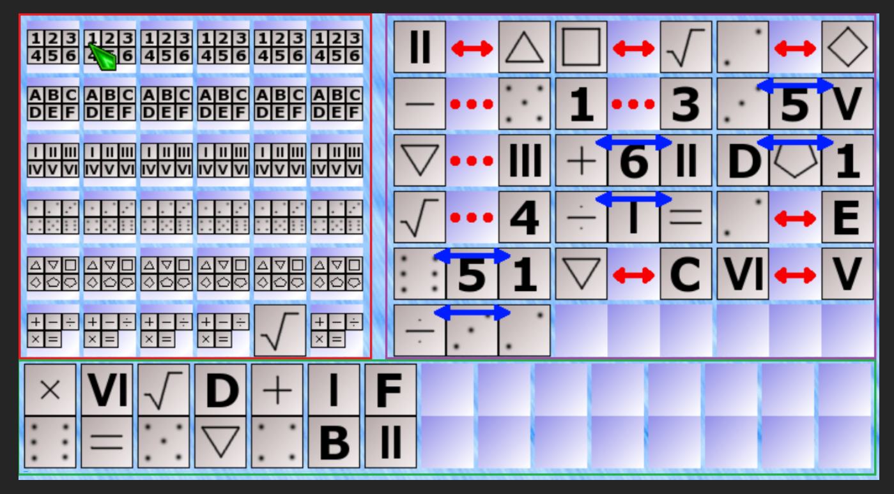

# Предварительная архитектура интерфейса

Статус: рабочий набросок по обсуждению и рисунку от 2026-11-10. Это основа для дальнейшего уточнения, а не окончательное техническое задание. Игровые правила и стек ещё не выбраны.

## Общая идея

Планируется одностраничная браузерная логическая игра. На широком экране интерфейс состоит из трёх областей:

- игровое поле — красная область на эскизе;
- горизонтальные подсказки — фиолетовая область;
- вертикальные подсказки — зелёная область.

В эскизе игровое поле имеет размер 6 × 6. Значение 5 × 5 из ранней заметки было ошибочным; принято 6 × 6. На эскизе вертикальные подсказки расположены под основными областями. На узком экране блоки должны адаптивно перестраиваться без наложения и выхода содержимого за экран; точные правила для узких экранов пока не выбраны.

## Размеры элементов и блоков

Обозначение R — сторона квадратного элемента. Элементы должны иметь общий размер R.

- Горизонтальная подсказка занимает 3R по ширине и 1R по высоте.
- Если горизонтальная подсказка состоит из двух элементов, место для отсутствующего центрального элемента сохраняется, чтобы габариты подсказок оставались одинаковыми.
- Вертикальная подсказка занимает 1R по ширине и 2R по высоте.
- В исходной заметке предложено минимальное значение R = 30px; оно предварительное и требует проверки на адаптивном макете.
- G — отдельный постоянный промежуток между самостоятельными блоками; он не увеличивается вместе с R. Числовое значение G ещё не выбрано.

Размеры R и G следует централизовать. Предварительный подход — CSS Custom Properties; использовать JavaScript для измерения размера стоит только если после проверки макета CSS не сможет обеспечить одинаковый R.

Связи и обозначения отношений не должны менять заданные внешние размеры подсказок. Если отдельный элемент связи занимает дополнительное место в обычном потоке, это увеличит блок и нарушит размеры 3R × 1R или 1R × 2R. Поэтому визуальное решение связи должно укладываться в зарезервированный размер; способ разметки и позиционирования пока открыт.

## Предварительное разделение интерфейса

Предложение для начального прототипа:

- HTML задаёт структуру страницы и областей.
- CSS отвечает за размеры, сетку, промежутки, адаптивность и оформление.
- JavaScript интерфейса обрабатывает действия пользователя и обновляет отображение.
- Отдельная логика игры на JavaScript хранит состояние и применяет правила.

Пока оба JavaScript-файла работают в браузере, оба являются частью frontend. Настоящего backend сейчас нет; границу с возможным будущим сервером определим позднее, когда будут ясны правила и требования игры.

Для макета игрового поля предварительно подходит CSS Grid, для групп подсказок с переносом целых блоков — Flexbox. Это направление, а не окончательный выбор до проверки реальной разметки.

## Порядок работы

Согласованное требование к будущему генератору: для каждого горизонтального типа отдельно разрешать или запрещать повторение строк в подсказке. Проверка самого отношения сравнивает позиции элементов независимо от строк; ограничения состава применяются при выборе подсказок генератором. Вертикальная подсказка всегда связывает разные строки. Подробные правила — в [GAME_RULES.md](GAME_RULES.md). Настройки ещё не привязаны к уровням сложности; реализация не начата.

1. Обсудить концепцию и правила игры без кода.
2. Создать простую HTML-структуру и базовую адаптивную раскладку без изображений и декоративного оформления.
3. В прототипе соединить первое действие в интерфейсе с правилом игры и отображением результата.
4. После проверки основных сценариев улучшать визуальный стиль.

## Открытые вопросы

- Как именно игрок отмечает варианты на поле 6 × 6 и что отображает каждая позиция.
- Какие типы подсказок и отношений существуют, как они представлены в данных и сколько элементов может быть в одной подсказке.
- Как отношения визуально помещаются в фиксированный размер блока, не увеличивая его габариты.
- Как рассчитывается R при изменении ширины окна и какое поведение выбрать, если экран слишком узкий для минимального размера.
- Какова будет итоговая структура файлов и когда понадобится реальный backend.
Эскиз, обсуждавшийся в чате, сохранён в репозитории:

