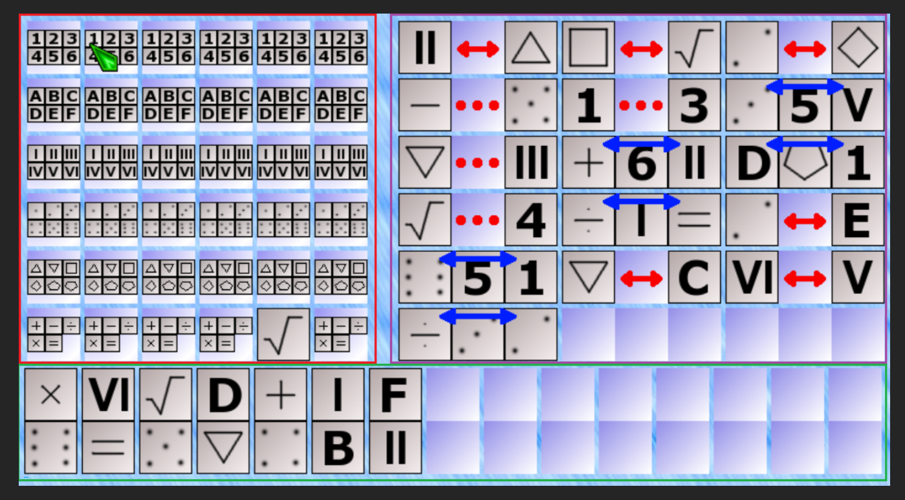

# Предварительная архитектура интерфейса

Статус: рабочий набросок интерфейса от 2026-11-10, дополнен моделью данных 2026-11-11. Правила уточняются в GAME_RULES.md; стек и структура модулей ещё не выбраны.

## Общая идея

Планируется одностраничная браузерная логическая игра. На широком экране интерфейс состоит из трёх областей:

- игровое поле — красная область на эскизе;
- горизонтальные подсказки — фиолетовая область;
- вертикальные подсказки — зелёная область.

В эскизе игровое поле имеет размер 6 × 6. Значение 5 × 5 из ранней заметки было ошибочным; принято 6 × 6. На эскизе вертикальные подсказки расположены под основными областями. На узком экране блоки должны адаптивно перестраиваться без наложения и выхода содержимого за экран; точные правила для узких экранов пока не выбраны.

## Размеры элементов и блоков

Обозначение R — сторона квадратного элемента. Элементы должны иметь общий размер R.

- Горизонтальная подсказка занимает 3R по ширине и 1R по высоте.
- Если горизонтальная подсказка состоит из двух элементов, место для отсутствующего центрального элемента сохраняется, чтобы габариты подсказок оставались одинаковыми.
- Вертикальная подсказка занимает 1R по ширине и 2R по высоте.
- В исходной заметке предложено минимальное значение R = 30px; оно предварительное и требует проверки на адаптивном макете.
- G — отдельный постоянный промежуток между самостоятельными блоками; он не увеличивается вместе с R. Числовое значение G ещё не выбрано.

Размеры R и G следует централизовать. Предварительный подход — CSS Custom Properties; использовать JavaScript для измерения размера стоит только если после проверки макета CSS не сможет обеспечить одинаковый R.

Связи и обозначения отношений не должны менять заданные внешние размеры подсказок. Если отдельный элемент связи занимает дополнительное место в обычном потоке, это увеличит блок и нарушит размеры 3R × 1R или 1R × 2R. Поэтому визуальное решение связи должно укладываться в зарезервированный размер; способ разметки и позиционирования пока открыт.

## Предварительное разделение интерфейса

Предложение для начального прототипа:

- HTML задаёт структуру страницы и областей.
- CSS отвечает за размеры, сетку, промежутки, адаптивность и оформление.
- JavaScript интерфейса обрабатывает действия пользователя и обновляет отображение.
- Отдельная логика игры на JavaScript хранит состояние и применяет правила.

Пока оба JavaScript-файла работают в браузере, оба являются частью frontend. Настоящего backend сейчас нет; границу с возможным будущим сервером определим позднее, когда будут ясны правила и требования игры.

Для макета игрового поля предварительно подходит CSS Grid, для групп подсказок с переносом целых блоков — Flexbox. Это направление, а не окончательный выбор до проверки реальной разметки.

## Рабочая основа данных (согласовано 2026-11-11)

### Уточнение границы слоёв

Слой 3 — движок, слой 2 — работа с интерфейсом. Движок не должен содержать alt, image, пути к ресурсам или зависеть от DOM. Ранний учебный пример каталога объектов с symbol/image заменён описанной ниже моделью ID.

- Слой 3 использует постоянные наборы уникальных ID, расположение в ответе и отношения подсказок. ID однозначно соответствует паре индексов постоянного каталога. Конкретные имена ID ещё не выбраны.
- Слой 2 сопоставляет идентичность элемента с alt/image и отображает состояние движка, передаёт действия пользователя обратно. Движок не импортирует эту таблицу отображения.
- Один и тот же ответ/набор подсказок должен оставаться корректным при замене картинок и языка alt.

### Каталог и скрытый ответ

- elements — постоянная двумерная матрица ID: строка набора и индекс элемента в его постоянном порядке. Оба индекса JavaScript начинаются с 0; второй не является колонкой ответа.
- elementPositionById — автоматически построенный объект-словарь: ID → { rowIndex, colIndex }, обратный доступ к elements. По просьбе пользователя используется имя colIndex; это колонка постоянного каталога, не положение в answer.
- answer — сгенерированная двумерная матрица тех же ID: строка и колонка в скрытом ответе. Строки сохраняют состав и позицию, меняется порядок внутри них.
- answerPositionById — автоматически построенный объект-словарь: ID → { rowIndex, colIndex }, обратный доступ к answer. Пользователь решил оставить полную пару координат для единообразия. Не хранить только колонку и не путать эту таблицу с elementPositionById.
- Два словаря — производные данные, не заполняемые вручную. Постоянная таблица строится из каталога, таблица ответа — из каждого нового ответа; способ предотвращения рассогласования при реализации ещё предстоит выбрать.
- Атомарные подсказки согласованы ниже. Пользователю понятнее явные ID в примерах, чем обращения через индексы каталога. ID не зависят от symbol/alt/image.
- Проверка готового ответа может сравнивать ID соответствующих клеток. Обратная таблица ответа удобна для запросов позиций, например при создании/проверке подсказок; решатель не должен получать скрытые позиции.
- Модель должна учитывать длины массивов, а не фиксированные 6 в алгоритмах. Основная игра остаётся 6 × 6; увеличение размера не гарантирует достаточную скорость решателя без измерений.
- Это изменяемая рабочая основа, не окончательный API. По запросу пользователя создан src/js/engine.js: учебный каталог ID 3 × 3, elementPositionById, функция fillElementPositionById() и её вызов. Ответ, подсказки и генератор ещё не реализованы; файл не подключён к HTML.

### Атомарные подсказки (согласовано 2026-11-11)

Все подсказки — объекты с явным type; участники хранятся как ID.

| type | Остальные поля | Смысл |
|---|---|---|
| leftOf | left, right | left строго левее right |
| near | side1, side2 | Соседние колонки, порядок сторон произвольный |
| between | side1, middle, side2 | middle между сторонами в трёх последовательных колонках; стороны могут поменяться местами |
| sameColumn | side1, side2 | Одна колонка, разные строки; порядок записи участников произвольный, ID нормализован по каталогу |
| given | element, colIndex | Исходно открытый элемент в колонке с индексом от 0; строка определяется через elementPositionById |

Названия first/second для near отклонены как создающие впечатление фиксированного порядка. Уточнение 2026-11-18: для sameColumn нормализуется порядок участников в ID, а поля top/bottom могут переставляться для изображения подсказки; отношение симметрично. Генерация пока записывает верхнюю строку первой, случайный обмен ещё добавить.

### Коллекции кандидатов и выбранных подсказок (согласовано 2026-11-11)

clueCandidates — объект с пятью свойствами-массивами: leftOf, near, between, sameColumn и given. Каждый массив содержит объекты соответствующего атомарного типа. Например, clueCandidates.near — свойство объекта, значением которого является массив, а clueCandidates.near[0] — один кандидат. Размеры массивов независимы.

cluesSelected — один общий массив выбранных объектов всех пяти типов. Выбранного кандидата удаляем из соответствующего массива clueCandidates и добавляем в cluesSelected. type остаётся в объекте, чтобы правило можно было определить после переноса. Отдельный флаг selected не нужен. Веса и лимит исходных открытий храним в настройках отдельно от кандидатов; численные значения ещё не выбраны.

Слой 2 распределяет выбранные подсказки на исходные открытия поля, горизонтальные и вертикальные. Прежнее предложение трёх отдельных массивов внутри движка заменено одним cluesSelected; оформление и текущее состояние игрока не входят в эту коллекцию.

### Текущее решение: отложено

Обсуждение этой структуры отложено по прямой просьбе пользователя. Идею обратного словаря сохранить как заметку, не проектировать текущее состояние до возвращения к теме.

Пользователь предложил повторить пару «матрица + PositionById» для текущего решения. Требуется различить подтверждённые/выбранные значения клеток и кандидатов. Для матрицы выбранных значений с не более одной позицией каждого ID подходит ID → одна позиция (или отсутствие при невыбранном элементе). Для кандидатов один ID может быть допустим в нескольких колонках, поэтому нужен набор позиций. Если интерфейс допускает повторные ошибочные установки одного ID, единственная позиция также недостаточна. Управление и правила допустимости таких состояний ещё не согласованы.

## Следующие этапы прототипа

Согласованное требование к будущему генератору: для каждого горизонтального типа отдельно разрешать или запрещать повторение строк в подсказке. Проверка самого отношения сравнивает позиции элементов независимо от строк; ограничения состава применяются при выборе подсказок генератором. Вертикальная подсказка всегда связывает разные строки. Подробные правила — в [GAME_RULES.md](GAME_RULES.md). Настройки ещё не привязаны к уровням сложности; реализация не начата.

1. Каталог ID и fillElementPositionById() реализованы в src/js/engine.js. Обсуждён generateRandomAnswer(): для каждой строки создаём отдельный список свободных индексов, случайно выбираем индекс из оставшихся, записываем ID в answer[rowIndex][colIndex] и удаляем выбранную колонку из свободных. Исходный каталог не меняется. Исправленный учебный пример пока только в docs/ai/HANDOFF.md, в движок не добавлен. Фиксированный ответ остаётся возможным контрольным примером, но не обязательным следующим заданием.
2. Проверить одно отношение «левее» на правильном и неправильном расположении. Постепенно добавить отношения, логический решатель и генерацию; конкретный объём каждого шага согласуется с пользователем.
3. Подключить минимальный HTML-интерфейс для отображения и проверки действий. Ранее предложенный порядок «сначала макет» уточнён: первым рассматривается небольшой прототип движка.
4. После проверки основных сценариев улучшать визуальный стиль.

## Открытые вопросы

- Как именно игрок отмечает варианты на поле 6 × 6 и что отображает каждая позиция.
- Реализация подготовки обратных словарей, кандидатов и настроек генерации; атомарные схемы и коллекции согласованы выше, отношения описаны в GAME_RULES.md.
- Как отношения визуально помещаются в фиксированный размер блока, не увеличивая его габариты.
- Как рассчитывается R при изменении ширины окна и какое поведение выбрать, если экран слишком узкий для минимального размера.
- Какова будет итоговая структура файлов и когда понадобится реальный backend.
Эскиз, обсуждавшийся в чате, сохранён в репозитории:

## Уточнение реализации 2026-11-17 (заменяет устаревшие статусы выше)
Генерация answer реализована, оба словаря PositionById заполняются. Координаты единообразно rowIndex/colIndex. Публичны startGame(), endGame(), getElements(), getVisibleElements(), getClues(); геттеры возвращают копии массивов, их строк или объектов подсказок. answer и внутренние функции закрыты. Общий getState() обсуждался, но не реализован.
visibleElements после старта пока [], после endGame содержит полное поле. Матрица закрытых клеток, статусы и действия игрока не реализованы. endGame используется в тестах как реальное раскрытие ответа, без специальных экспортов для тестов.
checkClue удалена из движка. В тестах она проверяет пять отношений по независимо построенному словарю открытого поля. Генератор строит истинные отношения по позициям ответа; повторная проверка внутри движка сейчас не нужна. Фактически реализован только given с полем colIndex.
Шесть тестов проходят, включая истинность выданных given. Полнота и отсутствие дублей ещё не проверяются. generateClueCandidates очищает группы и создаёт given по одному на ID; selectClues временно копирует всех кандидатов в cluesSelected вложенными forEach. getClues копирует объекты через map/spread. Настоящий отбор, остальные типы и решатель не реализованы.
Вопрос на будущее: пользователь может скрыть использованную подсказку и вернуть её; предварительно это состояние слоя 2, без удаления условия головоломки. Хранение и сохранение ещё согласовать.

## Генерация симметричных кандидатов — согласовано 2026-11-17

Обход начинается с постоянного каталога elements, позиции берутся из answerPositionById, соседи — из answer. Для near создаём пару только при порядке участников по каталогу (rowIndex, затем colIndex), исключая обратный обход. Для between каждый центральный ID и каждая пара элементов из соседних колонок рассматриваются один раз. После этого движок случайно выбирает порядок side1/side2; middle остаётся неизменным. Дубли не создаём, отдельного прохода для их удаления или обмена сторон не требуется.

Случайный порядок сторон не должен зависеть от расположения в скрытом ответе. Слой 2 получает уже подготовленные подсказки. Финальное перемешивание пока не нужно, если подсказки случайно выбираются из оставшихся кандидатов и выдаются в порядке выбора без сортировки по ответу. Реализация ещё не начата.

## Состояние и ID — 2026-11-18 (заменяет прежние статусы реализации)
Реализованы кандидаты given/sameColumn/leftOf; near/between ещё пусты. selectClues по-прежнему временно копирует всех кандидатов. В 3 × 3 создаются 9/9/27 соответственно. Все 9 сохранённых тестов проходят; полнота отдельно проверена разово, не покрыта сохранёнными тестами.
ID формируется при создании кандидата, сохраняется в cluesSelected и getClues. given: тип + элемент + colIndex; sameColumn: тип + ID из верхней строки каталога + ID из нижней; leftOf: тип + left + right, порядок значим. Тест отдельно проверяет соответствие ID содержимому и уникальность через Set.
Для sameColumn согласован случайный обмен top/bottom без изменения ID. Поля теперь относятся к изображению подсказки, а не к строкам поля. checkClue проверяет одну колонку и разные строки; тест ID нормализует участников по каталогу. Никакого случайного обмена пока нет в коде.
При будущих near/between их ID также не должен зависеть от случайной записи сторон. Для near пара нормализуется по каталогу (rowIndex, затем colIndex); у between центр выделен, стороны нормализованы. Форматы этих ID ещё реализовать и проверить.
Геттеры возвращают снимок уже созданной игры без новой генерации/перемешивания. Между двумя getClues неизменённого состояния порядок стабилен. Скрытые словари не экспортируются ради тестов; локальный помощник теста строит позиции по getElements или открытому полю.
## Обновление 2026-11-23 — near реализован, between ещё нет
near генерируется по соседним колонкам ответа с исключением зеркальных дублей по порядку каталога: строка, затем колонка. Поля side1/side2 пока записаны в этом порядке; ID near:первыйID:второйID. Случайного обмена ещё нет. Тест ID нормализует участников независимо; getClues не переставляет данные. Все 9 тестов прошли; полнота near отдельно не проверялась.
Названия в блоке: elementId/neighborId и elementCatalogPosition/neighborCatalogPosition. Сравниваются координаты каталога, а соседство определяется колонками ответа.
Последним обсуждён between: текущий элемент — middle, перебираем все пары из левой и правой соседних колонок, исключаем всех трёх из одной строки, стороны упорядочиваем по каталогу. Предложен ID between:middleID:firstSideID:secondSideID. Это схема для следующего согласования реализации, генератор ещё не написан. Для 3 × 3 ожидается 24 таких кандидата; выполнение не проверено.
Пользователь выбрал сначала завершить все генераторы и только потом добавить случайный порядок участников симметричных подсказок. Временное копирование всех кандидатов вместо отбора сохраняется.
## Состояние 2026-11-24 — заменяет прежние статусы реализации
Каталог сейчас 4 × 4 (number/letter/roman/domino). Все пять генераторов реализованы, выделены в generateCandidatesGiven/SameColumn/LeftOf/Near/Between. generateClueCandidates сохраняет общий обход каталога. Независимая проверка полного набора всех типов на 40 играх дала точное соответствие 304 кандидатам (16/24/96/48/120).
У sameColumn поля теперь side1/side2, как у near/between. В таблице выше старое пояснение top/bottom следует понимать исторически: участники симметричны. ID sameColumn остаётся по порядку строк каталога; near — по строке и колонке каталога; between имеет формат between:side1ID:middleID:side2ID с нормализованными сторонами. Центр отдельно не сортируется.
После selectClues вызывается randomizeClueParticipants: с вероятностью 0.5 меняет side1/side2 у sameColumn/near/between; ID и middle сохраняются, given/leftOf не затрагиваются. Пул кандидатов не перемешивается; getClues только копирует результат.
selectAllClues сохранена, но текущий selectClues вместо неё выбирает до десяти случайных подсказок. addRandomClue(candidates) удаляет случайный объект из группы и возвращает его/null. Равновероятны все кандидаты во всём пуле, не типы; общий индекс распределяется по длинам групп. Выбранную подсказку добавляет вызывающий код.
canSolve пока явно отмеченная заглушка clues.length > 9, а не решатель. Малый набор НЕ гарантированно решаем. Реальные веса, лимиты, логическая проверка и сокращение не реализованы. Исчерпание пула завершает цикл, не объявляя доказанную решаемость.
Тесты последнего запуска прошли 10/10, но статистический тест обмена рассчитан на большой полный набор и после отбора десяти элементов может случайно падать. Требует отдельного согласованного изменения; нельзя считать его стабильным или заявлять готовность CI по одному запуску.
## Обновление 2026-11-25 — состояние решателя и ручной просмотр
createPossibleColumnsById(sourceElements) создаёт отдельное состояние: ID → новый массив возможных колонок. Каталог не расширяется рабочими свойствами. Пользователь добавил создание состояния в selectClues, но оно пока не участвует в проверке и сокращении вариантов; canSolve остаётся заглушкой количества.
Обсуждена инкрементальная организация: при добавлении истинной подсказки продолжать существующее состояние, повторно применяя все выбранные условия и правила строк до стабильности. При удалении подсказки прежние исключения могут быть необоснованны — проще пересчитать с начала. Подход ещё не реализован; интерфейс и различение решения/противоречия/остановки предстоит согласовать.
Для ручного просмотра создан scripts/preview.mjs на публичных методах движка. Форматирование и короткие подписи находятся в скрипте, не движке. Три равных блока на подсказку, отдельные given; в открытой матрице given выделены круглыми скобками. Это инструмент просмотра, не игровой UI.
Статистический тест обмена отключён через test.skip по согласованию: 9 активных прошли, 1 пропущен. Последний запуск был до конструктора вариантов; новый код решателя не проверен выполнением. Потребуется подготовленный набор/управляемая случайность для возврата теста.