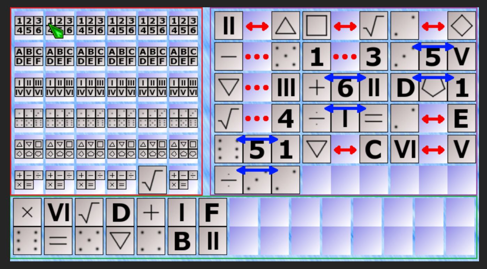

# Предварительная архитектура интерфейса

Статус: рабочий набросок интерфейса от 2026-11-10, дополнен моделью данных 2026-11-11. Правила уточняются в GAME_RULES.md; стек и структура модулей ещё не выбраны.

## Общая идея

Планируется одностраничная браузерная логическая игра. На широком экране интерфейс состоит из трёх областей:

- игровое поле — красная область на эскизе;
- горизонтальные подсказки — фиолетовая область;
- вертикальные подсказки — зелёная область.

В эскизе игровое поле имеет размер 6 × 6. Значение 5 × 5 из ранней заметки было ошибочным; принято 6 × 6. На эскизе вертикальные подсказки расположены под основными областями. На узком экране блоки должны адаптивно перестраиваться без наложения и выхода содержимого за экран; точные правила для узких экранов пока не выбраны.

## Размеры элементов и блоков

Обозначение R — сторона квадратного элемента. Элементы должны иметь общий размер R.

- Горизонтальная подсказка занимает 3R по ширине и 1R по высоте.
- Если горизонтальная подсказка состоит из двух элементов, место для отсутствующего центрального элемента сохраняется, чтобы габариты подсказок оставались одинаковыми.
- Вертикальная подсказка занимает 1R по ширине и 2R по высоте.
- В исходной заметке предложено минимальное значение R = 30px; оно предварительное и требует проверки на адаптивном макете.
- G — отдельный постоянный промежуток между самостоятельными блоками; он не увеличивается вместе с R. Числовое значение G ещё не выбрано.

Размеры R и G следует централизовать. Предварительный подход — CSS Custom Properties; использовать JavaScript для измерения размера стоит только если после проверки макета CSS не сможет обеспечить одинаковый R.

Связи и обозначения отношений не должны менять заданные внешние размеры подсказок. Если отдельный элемент связи занимает дополнительное место в обычном потоке, это увеличит блок и нарушит размеры 3R × 1R или 1R × 2R. Поэтому визуальное решение связи должно укладываться в зарезервированный размер; способ разметки и позиционирования пока открыт.

## Предварительное разделение интерфейса

Предложение для начального прототипа:

- HTML задаёт структуру страницы и областей.
- CSS отвечает за размеры, сетку, промежутки, адаптивность и оформление.
- JavaScript интерфейса обрабатывает действия пользователя и обновляет отображение.
- Отдельная логика игры на JavaScript хранит состояние и применяет правила.

Пока оба JavaScript-файла работают в браузере, оба являются частью frontend. Настоящего backend сейчас нет; границу с возможным будущим сервером определим позднее, когда будут ясны правила и требования игры.

Для макета игрового поля предварительно подходит CSS Grid, для групп подсказок с переносом целых блоков — Flexbox. Это направление, а не окончательный выбор до проверки реальной разметки.

## Рабочая основа данных (согласовано 2026-11-11)

### Уточнение границы слоёв

Слой 3 — движок, слой 2 — работа с интерфейсом. Движок не должен содержать alt, image, пути к ресурсам или зависеть от DOM. Ранний учебный пример каталога объектов с symbol/image заменён описанной ниже моделью ID.

- Слой 3 использует постоянные наборы уникальных ID, расположение в ответе и отношения подсказок. ID однозначно соответствует паре индексов постоянного каталога. Конкретные имена ID ещё не выбраны.
- Слой 2 сопоставляет идентичность элемента с alt/image и отображает состояние движка, передаёт действия пользователя обратно. Движок не импортирует эту таблицу отображения.
- Один и тот же ответ/набор подсказок должен оставаться корректным при замене картинок и языка alt.

### Каталог и скрытый ответ

- elements — постоянная двумерная матрица ID: строка набора и индекс элемента в его постоянном порядке. Оба индекса JavaScript начинаются с 0; второй не является колонкой ответа.
- elementIndexById — автоматически построенный объект-словарь: ID → { rowIndex, colIndex }, обратный доступ к elements. По просьбе пользователя используется имя colIndex; это колонка постоянного каталога, не положение в answer.
- answer — сгенерированная двумерная матрица тех же ID: строка и колонка в скрытом ответе. Строки сохраняют состав и позицию, меняется порядок внутри них.
- answerPositionById — автоматически построенный объект-словарь: ID → { rowIndex, columnIndex }, обратный доступ к answer. Пользователь решил оставить полную пару координат для единообразия. Не хранить только колонку и не путать эту таблицу с elementIndexById.
- Два словаря — производные данные, не заполняемые вручную. Постоянная таблица строится из каталога, таблица ответа — из каждого нового ответа; способ предотвращения рассогласования при реализации ещё предстоит выбрать.
- Атомарные подсказки согласованы ниже. Пользователю понятнее явные ID в примерах, чем обращения через индексы каталога. ID не зависят от symbol/alt/image.
- Проверка готового ответа может сравнивать ID соответствующих клеток. Обратная таблица ответа удобна для запросов позиций, например при создании/проверке подсказок; решатель не должен получать скрытые позиции.
- Модель должна учитывать длины массивов, а не фиксированные 6 в алгоритмах. Основная игра остаётся 6 × 6; увеличение размера не гарантирует достаточную скорость решателя без измерений.
- Это изменяемая рабочая основа, не окончательный API. По запросу пользователя создан src/js/engine.js: учебный каталог ID 3 × 3, elementIndexById, функция fillElementIndexById() и её вызов. Ответ, подсказки и генератор ещё не реализованы; файл не подключён к HTML.

### Атомарные подсказки (согласовано 2026-11-11)

Все подсказки — объекты с явным type; участники хранятся как ID.

| type | Остальные поля | Смысл |
|---|---|---|
| leftOf | left, right | left строго левее right |
| near | side1, side2 | Соседние колонки, порядок сторон произвольный |
| between | side1, middle, side2 | middle между сторонами в трёх последовательных колонках; стороны могут поменяться местами |
| sameColumn | top, bottom | Одна колонка; top из строки с меньшим rowIndex, bottom — с большим; соседство строк не требуется |
| given | element, columnIndex | Исходно открытый элемент в колонке с индексом от 0; строка определяется через elementIndexById |

Названия first/second для near отклонены как создающие впечатление фиксированного порядка. Для sameColumn порядок записи top/bottom соответствует фиксированному порядку строк и помогает исключать дубли; проверяемое отношение остаётся симметричным.

### Коллекции кандидатов и выбранных подсказок (согласовано 2026-11-11)

clueCandidates — объект с пятью свойствами-массивами: leftOf, near, between, sameColumn и given. Каждый массив содержит объекты соответствующего атомарного типа. Например, clueCandidates.near — свойство объекта, значением которого является массив, а clueCandidates.near[0] — один кандидат. Размеры массивов независимы.

cluesSelected — один общий массив выбранных объектов всех пяти типов. Выбранного кандидата удаляем из соответствующего массива clueCandidates и добавляем в cluesSelected. type остаётся в объекте, чтобы правило можно было определить после переноса. Отдельный флаг selected не нужен. Веса и лимит исходных открытий храним в настройках отдельно от кандидатов; численные значения ещё не выбраны.

Слой 2 распределяет выбранные подсказки на исходные открытия поля, горизонтальные и вертикальные. Прежнее предложение трёх отдельных массивов внутри движка заменено одним cluesSelected; оформление и текущее состояние игрока не входят в эту коллекцию.

### Текущее решение: отложено

Обсуждение этой структуры отложено по прямой просьбе пользователя. Идею обратного словаря сохранить как заметку, не проектировать текущее состояние до возвращения к теме.

Пользователь предложил повторить пару «матрица + PositionById» для текущего решения. Требуется различить подтверждённые/выбранные значения клеток и кандидатов. Для матрицы выбранных значений с не более одной позицией каждого ID подходит ID → одна позиция (или отсутствие при невыбранном элементе). Для кандидатов один ID может быть допустим в нескольких колонках, поэтому нужен набор позиций. Если интерфейс допускает повторные ошибочные установки одного ID, единственная позиция также недостаточна. Управление и правила допустимости таких состояний ещё не согласованы.

## Следующие этапы прототипа

Согласованное требование к будущему генератору: для каждого горизонтального типа отдельно разрешать или запрещать повторение строк в подсказке. Проверка самого отношения сравнивает позиции элементов независимо от строк; ограничения состава применяются при выборе подсказок генератором. Вертикальная подсказка всегда связывает разные строки. Подробные правила — в [GAME_RULES.md](GAME_RULES.md). Настройки ещё не привязаны к уровням сложности; реализация не начата.

1. Каталог ID и fillElementIndexById() реализованы в src/js/engine.js. Обсуждён generateRandomAnswer(): для каждой строки создаём отдельный список свободных индексов, случайно выбираем индекс из оставшихся, записываем ID в answer[rowIndex][colIndex] и удаляем выбранную колонку из свободных. Исходный каталог не меняется. Исправленный учебный пример пока только в docs/ai/HANDOFF.md, в движок не добавлен. Фиксированный ответ остаётся возможным контрольным примером, но не обязательным следующим заданием.
2. Проверить одно отношение «левее» на правильном и неправильном расположении. Постепенно добавить отношения, логический решатель и генерацию; конкретный объём каждого шага согласуется с пользователем.
3. Подключить минимальный HTML-интерфейс для отображения и проверки действий. Ранее предложенный порядок «сначала макет» уточнён: первым рассматривается небольшой прототип движка.
4. После проверки основных сценариев улучшать визуальный стиль.

## Открытые вопросы

- Как именно игрок отмечает варианты на поле 6 × 6 и что отображает каждая позиция.
- Реализация подготовки обратных словарей, кандидатов и настроек генерации; атомарные схемы и коллекции согласованы выше, отношения описаны в GAME_RULES.md.
- Как отношения визуально помещаются в фиксированный размер блока, не увеличивая его габариты.
- Как рассчитывается R при изменении ширины окна и какое поведение выбрать, если экран слишком узкий для минимального размера.
- Какова будет итоговая структура файлов и когда понадобится реальный backend.
Эскиз, обсуждавшийся в чате, сохранён в репозитории:

